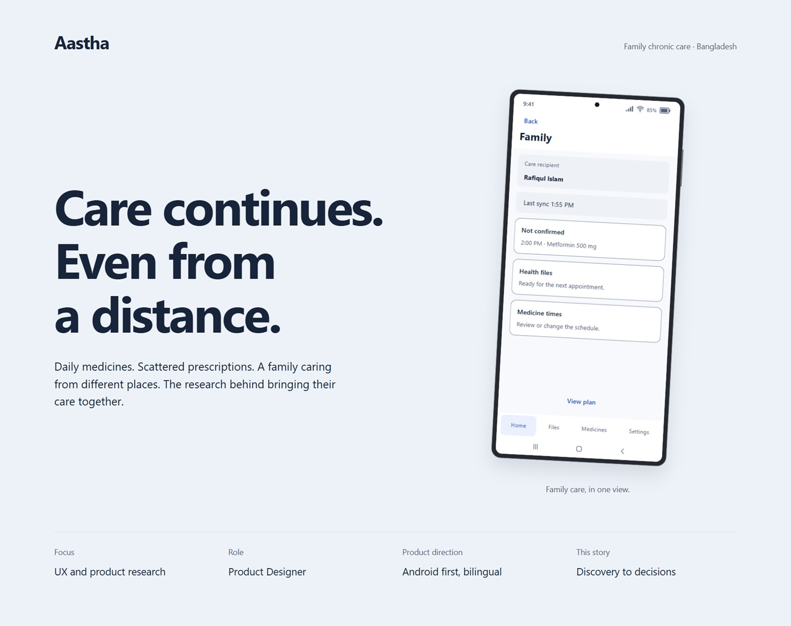
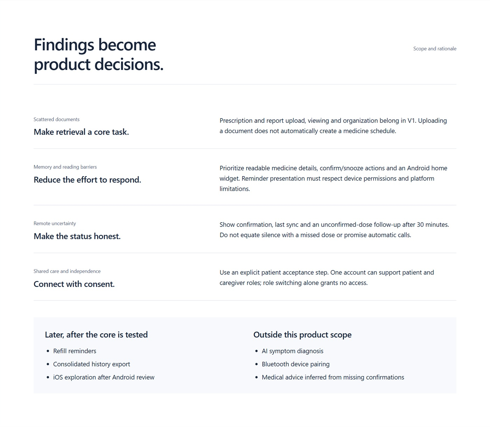
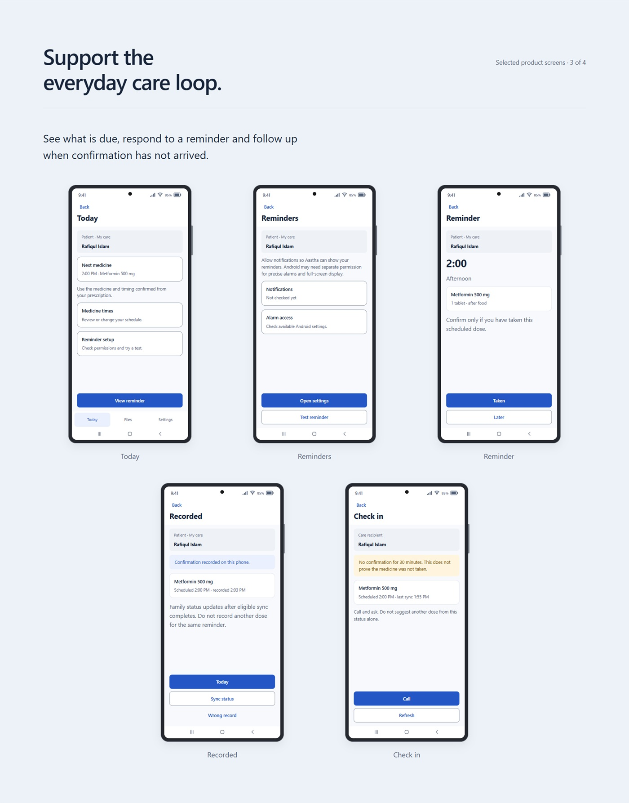

# Aastha | Family Care App UX Case Study

An Android-first product design case study for family chronic-care coordination in Bangladesh, by Ahasanul Karim Khan. Aastha brings prescription and report retrieval, medicine schedules and patient-authorized caregiver updates into one proposed care experience, with Bengali and English designs.

[Read the Behance case study](https://www.behance.net/gallery/257966521/Aastha-Family-Care-App-UX-Case-Study) · [Design decisions](docs/design-decisions.md) · [Asset notes](docs/assets.md)

*Approved V5 case-study cover. The device contains a local design rendering, not a photograph of a running Android app.*

## My contribution

My work covers research synthesis, the patient and caregiver journeys, information architecture, bilingual interface design, a reusable Figma design system and connected prototype flows. The case study connects care-record retrieval and remote uncertainty to concrete product decisions.

The designer confirmed qualitative interviews and home observations with eight participants: five working caregivers and three older patients. This repository summarizes the existing case-study synthesis; raw recordings and transcripts were not inspected during GitHub preparation. Personas and their dialogue are illustrative composites, not participant identities or verbatim interview quotes.

## Key design decisions

- Make prescription and report retrieval a core task; uploading a file does not automatically create a medicine schedule.
- Keep patient consent separate from role switching and payment. Selecting Caregiver does not grant access to another person's records.
- Distinguish an unconfirmed dose from a dose known not to have been taken, and show last-sync context.
- Use readable reminder details and direct response actions, while acknowledging Android permissions and device constraints.
- Preserve existing records and local reminders after Premium expiry; explain changes to paid synchronization and new-upload limits.

*Design rationale panel from the approved V5 presentation, not a UI screenshot or measured outcome report.*

*Today, reminder setup, reminder response, recorded confirmation and caregiver check-in. These are local HTML renderings of existing design definitions inside illustrative Android device frames, not exact Figma screenshot exports. Names, medicine details and times are demonstration content. Long screens show selected initial viewports.*

## Scope and evidence limits

The design scope includes an Android-first patient and caregiver experience in Bengali and English, plus a separately visited subscription website design. This GitHub package curates the existing mobile case study; it contains documentation and selected presentation images, with no production application or payment service.

The approved case-study presentation is complete and publicly linked. That does not establish a launched app, working backend, reliable alarms or synchronization, payment activation, clinical effectiveness or full accessibility acceptance. Existing review records retain open native playback, device, enlarged-text and comprehensive rendered-audit work.

Success metrics in the case study are proposed targets. No achieved adherence improvement, retrieval time, retention or conversion result is claimed. No client engagement is inferred. Storage architecture is a proposal with provider, region, retention and operating decisions still open.

## Repository contents

- `docs/design-decisions.md`: reasoning and validation boundaries.
- `docs/assets.md`: provenance and presentation limitations.
- `assets/`: selected approved V5 JPEG panels.

Private research records, participant information, internal audit exports and the source Figma file are not included. This repository grants no reuse license for the design or third-party assets.
